# White Eyes

> 드론·CCTV 영상에서 사람을 세고, 구역별 혼잡을 한눈에 보여주는 군중 관제 서비스

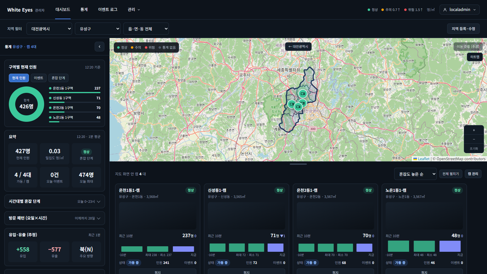

높은 곳에서 찍은 영상(드론·CCTV)에서 사람을 찾아 따라가며 **구역별 인원·밀집도·유입/유출·체류 시간**을 쌓고, 지도·그래프·대시보드로 보여준다. 혼잡이 심해지거나 인원이 갑자기 늘면 이벤트로 기록해 관리자에게 알린다. 쌓인 통계는 시간대·요일별 이용 패턴 분석, 상권 분석, 도시 설계 같은 곳에 쓸 수 있게 하는 것이 최종 목표다.

이 프로젝트는 취업 포트폴리오를 위한 팀 프로젝트(2차)이다. 명세 → 이슈 → PR 순서로, 실무 프로세스를 따라 하되 과하게 설계하지 않는 것을 원칙으로 했다.

> 위 화면과 아래 화면은 로컬에서 `docker compose`로 직접 띄워 캡처했다. 장기 통계 그래프에는 시연용 데이터가 포함되어 있고, 화면에도 '시연용 데이터 포함'으로 표시된다. 분석 영상의 원본 장면은 출처 문제로 싣지 않았다.

## 목차
- [왜 만들었나](#왜-만들었나)
- [주요 기능](#주요-기능)
- [화면](#화면)
- [시스템 구성](#시스템-구성)
- [저장소 안내](#저장소-안내)
- [기술 스택](#기술-스택)
- [로컬에서 실행하기](#로컬에서-실행하기)
- [팀](#팀)
- [일하는 방식](#일하는-방식)
- [알려진 한계](#알려진-한계)

## 왜 만들었나

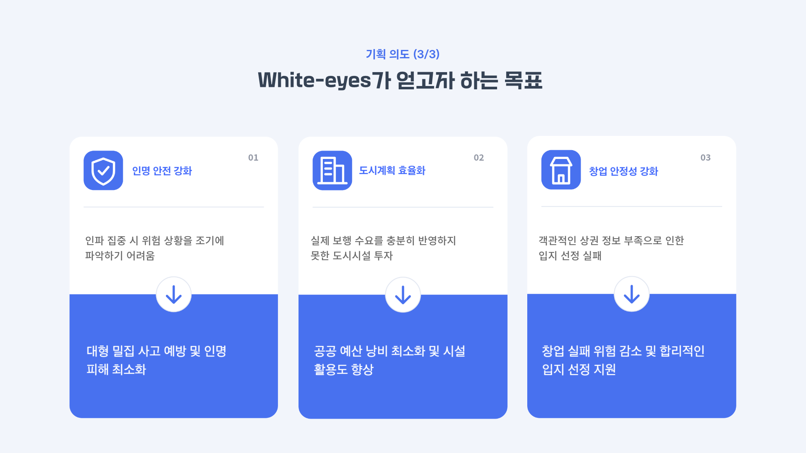

- **인명 안전**: 인파가 몰릴 때 위험을 일찍 알아차리기 어렵다.
- **도시계획**: 실제 보행 수요를 반영하지 못한 시설 투자가 생긴다.
- **창업**: 객관적인 상권 정보가 부족해 입지 선정에 실패한다.

## 주요 기능

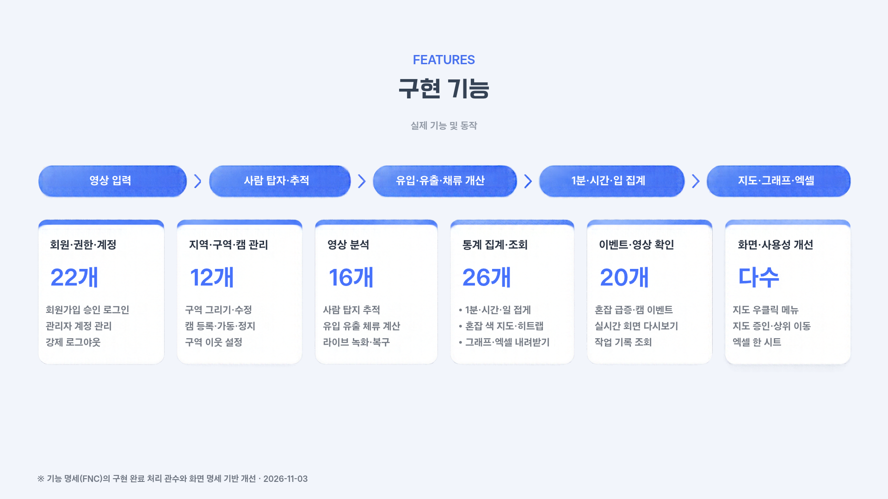

### 사용자 (통계를 보는 고객)
- 시 → 구 → 동 → 구역 순으로 들어가는 **지도**, 혼잡 단계(정상·주의·위험) 색 표시
- 기간·단위(1분 ~ 1년)별 **통계 그래프**, 점을 눌러 한 단계씩 들어가기
- **대시보드**: 현재 인원·밀집도·유입/유출·주요 이동 방향, 피크 타임, 요일별 방문 패턴
- 구역 간 이동 흐름, 시간대별 **히트맵**
- 통계 **엑셀 내려받기**
- 사람이 찍힌 영상은 볼 수 없고 통계만 제공한다.

### 관리자 (서비스를 운영하는 직원)
- 지도에서 **구역을 그려** 등록하고, 캠을 등록·가동·정지
- **실시간 분석 화면**(박스를 그린 스트림)과 **다시보기**(원본 영상 위에 탐지 박스 표시)
- 혼잡·급증·캠 이상 **이벤트** 알림, 확인 → 조치완료 처리
- 사용자 승인/미승인, 관리자 계정 관리, 최근 활동 확인·강제 로그아웃, **작업 기록** 조회

### 분석 (영상 분석 서버)
- 사람 탐지(VisDrone YOLOv8m)와 추적(PointTracker), 유입/유출 판정, 체류 시간 계산
- 결과를 1초마다 관리자 앱에 전송, 영상은 1분 단위로 녹화
- 라이브 캠 1대는 실시간 분석, 나머지는 더미 캠(영상 1회 분석 후 결과 재사용)

## 화면

### 관리자 앱

| 대시보드 + 히트맵 | 통계 그래프 |
|---|---|
| 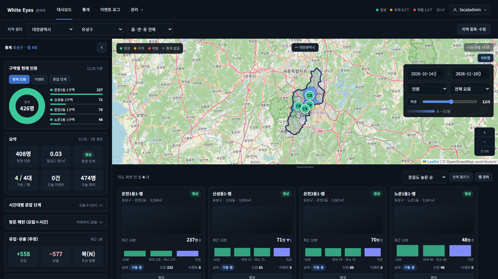 | 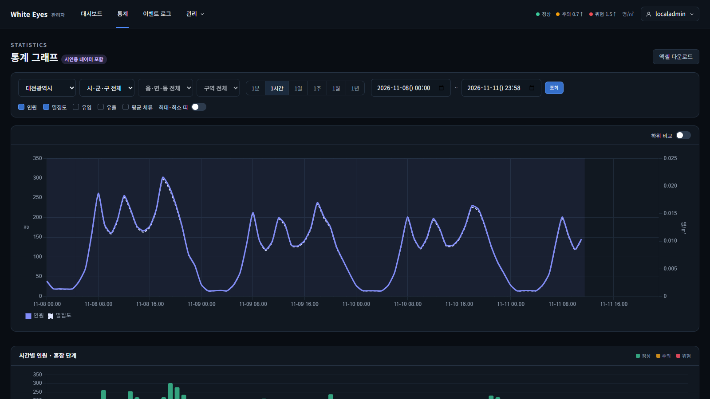 |

| 구역 관리 (지도에서 구역 그리기) | 캠 관리 |
|---|---|
| 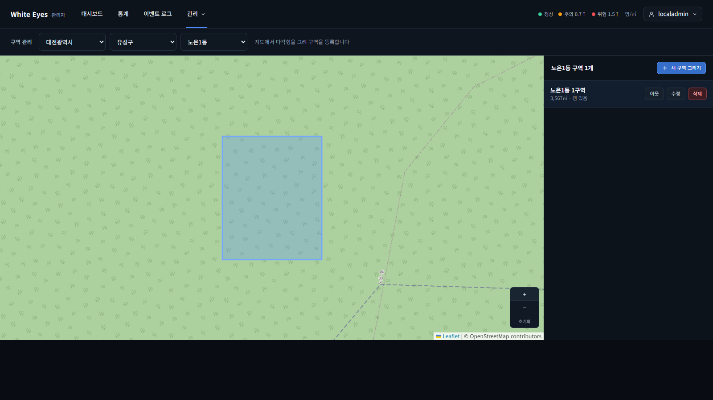 | 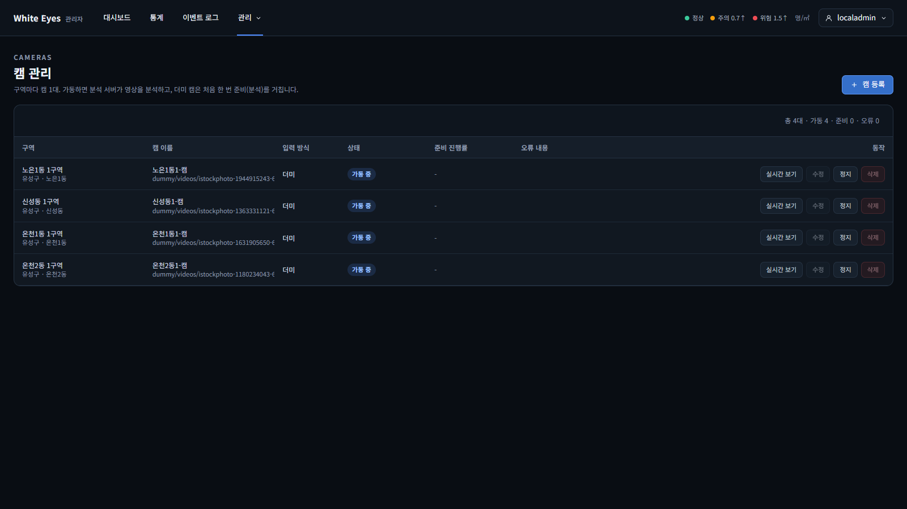 |

### 사용자 앱

| 대시보드 | 통계 그래프 |
|---|---|
| 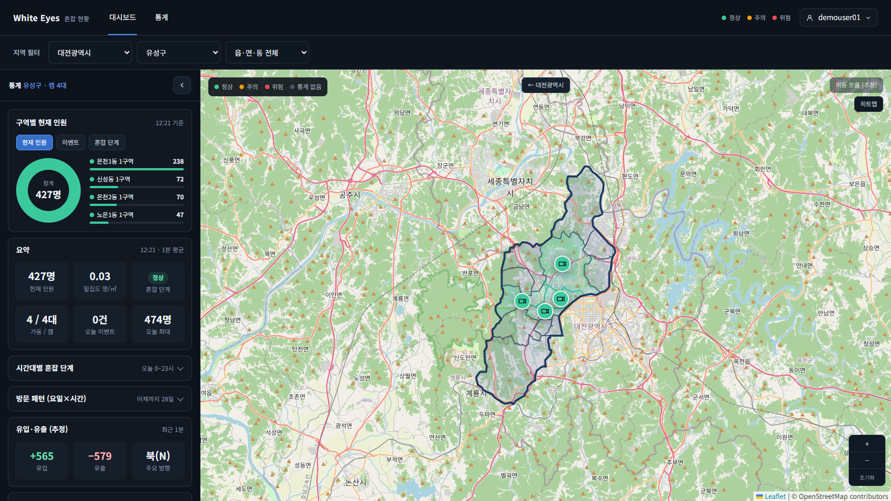 | 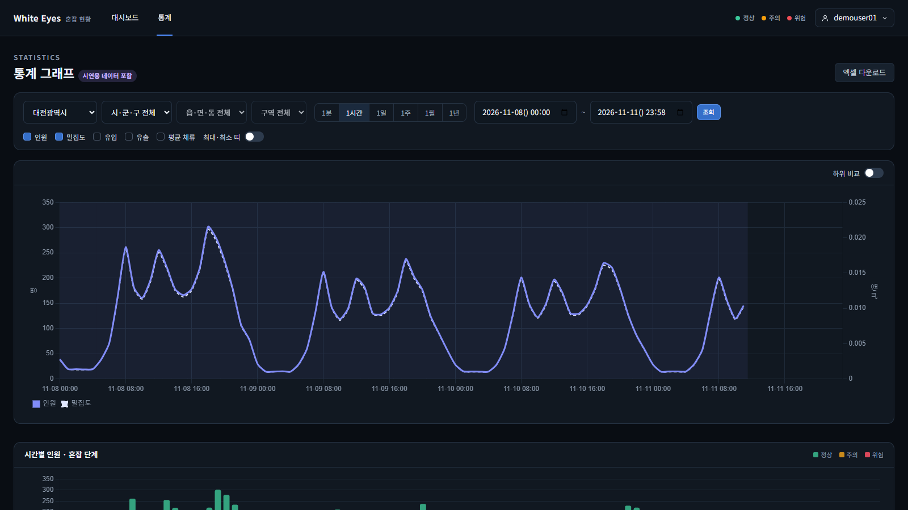 |

| 로그인 | 회원가입 |
|---|---|
| 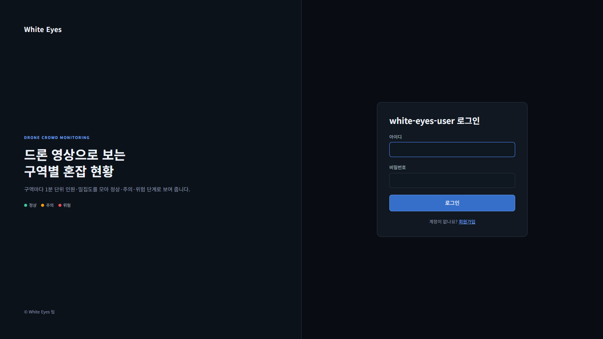 | 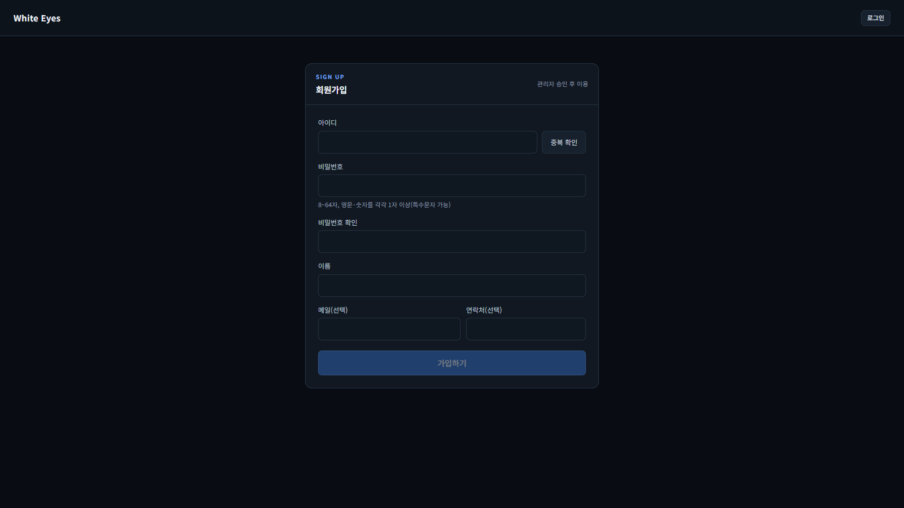 |

> 대시보드의 캠 카드는 원본 영상이 보이지 않도록 가려서 캡처했다.

## 시스템 구성

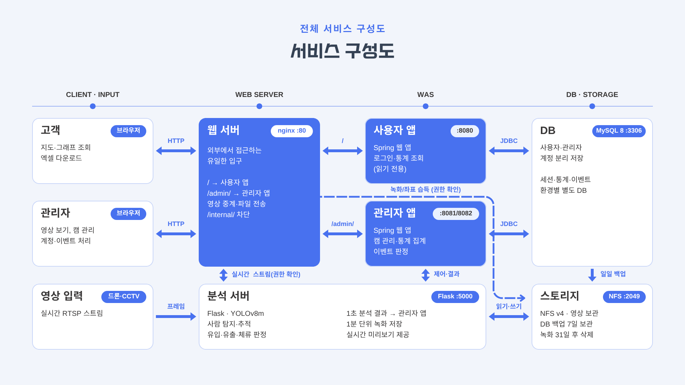

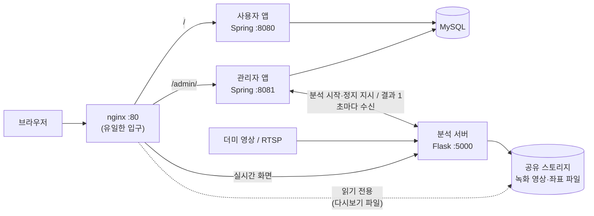

- 외부에서 접근할 수 있는 곳은 nginx 하나다. 사용자 앱·관리자 앱·분석 서버는 직접 열지 않는다.
- 분석 서버가 보낸 결과를 관리자 앱이 받아 1분·시간별·일별로 집계한다. 예약 작업과 DB 마이그레이션(Flyway)은 관리자 앱에서만 실행한다.
- 사용자 앱과 관리자 앱은 `common` 모듈(데이터 모델, 권한, 통계 조회·화면)을 함께 쓴다.
- 자세한 구성과 이유는 [overview.md](https://github.com/white-eyes1/white-eyes-docs/blob/main/overview.md)에 있다.

<details>
<summary>서버 환경 (VirtualBox VM 6대 구성)</summary>

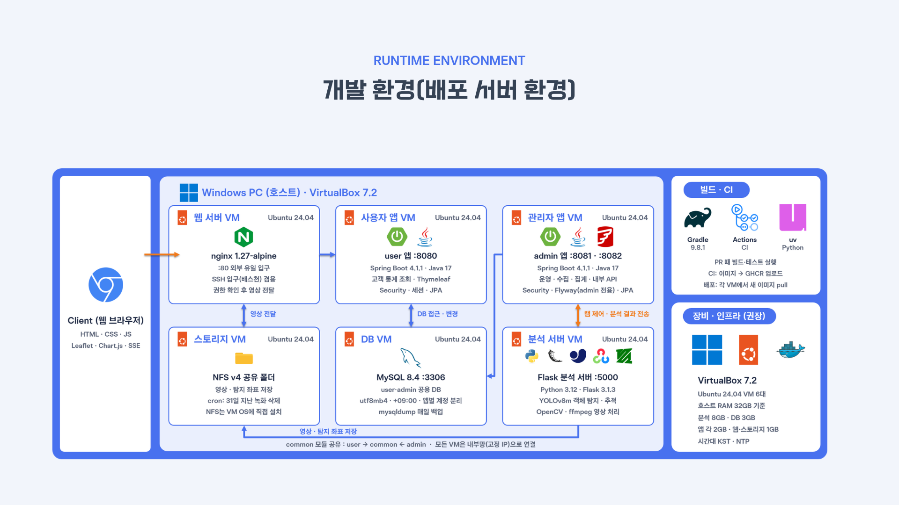

</details>

## 저장소 안내

| 저장소 | 역할 | 바로가기 |
|---|---|---|
| **white-eyes-introduce** | 프로젝트 소개 (지금 보는 문서) | - |
| **white-eyes-spring** | 사용자 앱·관리자 앱 (Java 17, Spring Boot) | [저장소](https://github.com/white-eyes1/white-eyes-spring) |
| **white-eyes-flask** | 영상 분석 서버 (Python, Flask, YOLOv8) | [저장소](https://github.com/white-eyes1/white-eyes-flask) |
| **white-eyes-docs** | 명세·API 계약·결정 기록·시험 보고서 (명세의 원본) | [저장소](https://github.com/white-eyes1/white-eyes-docs) · [INDEX](https://github.com/white-eyes1/white-eyes-docs/blob/main/INDEX.md) |
| **white-eyes-deploy** | docker compose로 전체를 한 번에 띄우는 설정 (nginx, MySQL 포함) | [저장소](https://github.com/white-eyes1/white-eyes-deploy) |
| **white-eyes-assets** | 더미 영상·모델 가중치 공유 (비공개) | - |

처음 보는 사람에게는 이 순서를 추천한다.
1. 이 문서로 전체 그림 파악
2. [overview.md](https://github.com/white-eyes1/white-eyes-docs/blob/main/overview.md)로 서비스 구성과 동작 흐름 읽기
3. 관심 있는 쪽(spring 또는 flask) README로 이동
4. [deploy](https://github.com/white-eyes1/white-eyes-deploy)로 직접 실행해 보기

## 기술 스택

| 영역 | 사용 기술 |
|---|---|
| 사용자·관리자 앱 | Java 17, Spring Boot 4.1.1, Gradle(멀티모듈), Spring Security, Spring Data JPA, Spring Session JDBC, Thymeleaf, SSE |
| 화면 | HTML/CSS/JavaScript, Chart.js, Leaflet + OpenStreetMap |
| 분석 서버 | Python 3.12, Flask, Ultralytics YOLOv8(VisDrone 가중치), PyTorch(CPU), OpenCV, ffmpeg |
| DB | MySQL 8.4, Flyway(마이그레이션) |
| 인프라 | nginx(리버스 프록시), Docker / Docker Compose, (설계) VirtualBox VM + NFS |
| 협업 | GitHub(이슈·PR), GitHub Actions(CI) |
| 문서 | Markdown 명세, 결정 기록(ADR 형식) |

## 로컬에서 실행하기

[white-eyes-deploy](https://github.com/white-eyes1/white-eyes-deploy)의 README를 따른다. 요약하면 다음과 같다.

```bash
# WSL2(Ubuntu) 안에서, 세 저장소를 한 폴더에 나란히 clone
git clone https://github.com/white-eyes1/white-eyes-spring.git
git clone https://github.com/white-eyes1/white-eyes-flask.git
git clone https://github.com/white-eyes1/white-eyes-deploy.git
cd white-eyes-deploy
cp .env.example .env     # 값을 채운다 (비밀값은 커밋하지 않는다)
docker compose up -d --build
```

- 사용자 앱 `http://localhost/`, 관리자 앱 `http://localhost/admin/`
- 분석에 쓰는 모델 가중치와 더미 영상은 저장소에 없다. 받는 방법은 deploy·flask README를 본다.

## 팀

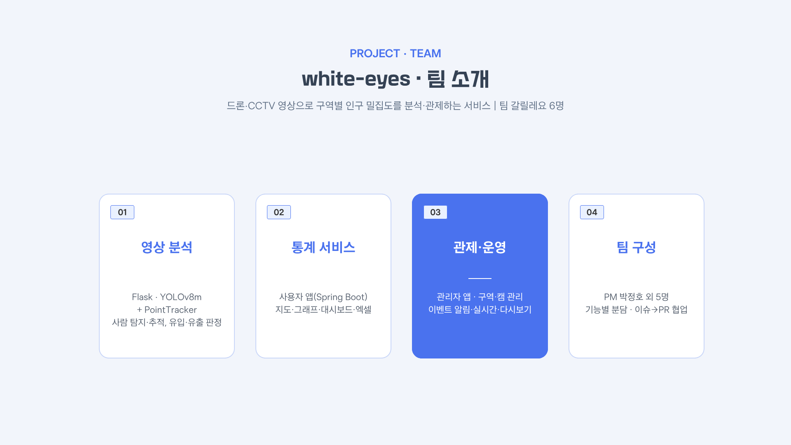

| 이름 | 역할 | 담당 | GitHub |
|---|---|---|---|
| 박정호 | 팀장(PM) | 프로젝트 관리, 공통 화면 틀, 배포 | [@Kanabig](https://github.com/Kanabig) |
| 전종호 | 팀원 | 통계 화면(그래프·엑셀·히트맵), 회원 관리, 시연 데이터 | [@qlqldks985](https://github.com/qlqldks985) |
| 이윤호 | 팀원 | 보안·계정, 혼잡·급증 이벤트와 알림 | [@ho8566z](https://github.com/ho8566z) |
| 이규찬 | 팀원 | 구역·캠 관리, 실시간·다시보기 영상, 지도 | [@guechanlee](https://github.com/guechanlee) |
| 장동근 | 팀원 | 분석 서버(탐지·추적·유입/유출), 시간별·일별 통계 집계 | [@j75390](https://github.com/j75390) |
| 김대명 | 팀원 | 테스트, 분석 결과 수신·1분 통계, 혼잡 단계 판정 | [@rlaeoaud7018](https://github.com/rlaeoaud7018) |

<details>
<summary>팀원 소개와 개인별 기여</summary>

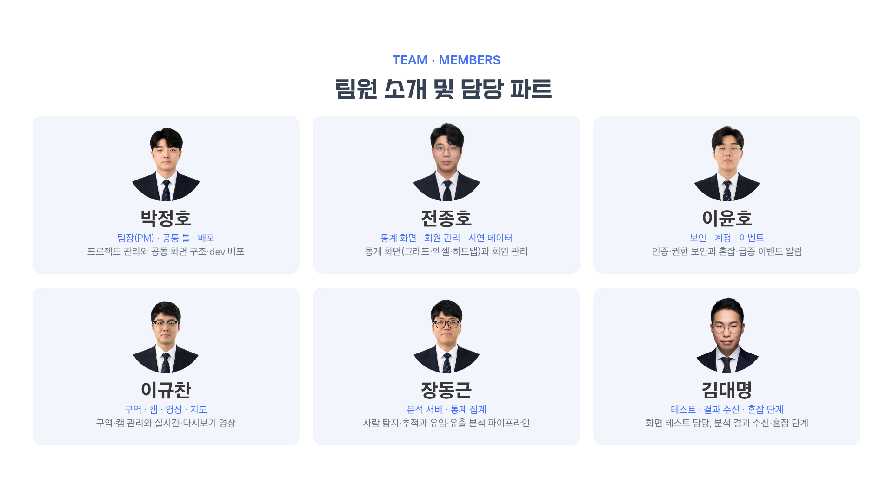

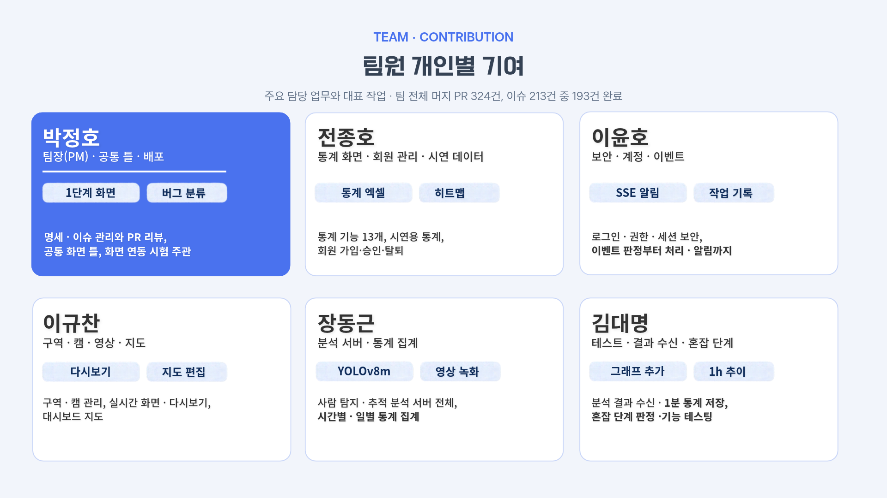

</details>

## 일하는 방식

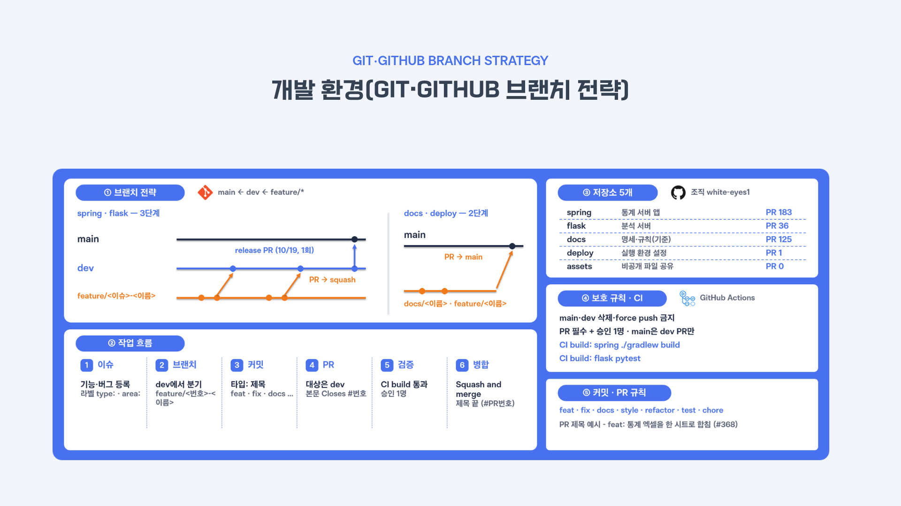

- **명세가 먼저다.** 모든 기능은 [white-eyes-docs](https://github.com/white-eyes1/white-eyes-docs)의 명세(`FNC-*` 기능, `SCR-*` 화면, `API`)를 읽고 나서 만든다. 명세와 다르게 만들어야 하면 명세 PR을 먼저 올린다.
- **이슈 하나 = 브랜치 하나 = PR 하나.** 브랜치는 `feature/<이슈 번호>-<이름>`, PR 대상은 항상 `dev`이고 `main`·`dev`에 직접 push하지 않는다.
- **검수 기준은 테스트로 만든다.** CI(GitHub Actions)가 빌드·테스트·형식 검사를 돌린다.
- **커밋 메시지 규칙**을 세 저장소에 같이 적용한다 ([commit-convention.md](https://github.com/white-eyes1/white-eyes-docs/blob/main/commit-convention.md)).
- **결정과 트러블슈팅을 기록한다.** 선택의 이유는 [decisions/](https://github.com/white-eyes1/white-eyes-docs/tree/main/decisions), 겪은 문제는 각 저장소의 `docs/troubleshooting/`에 남긴다.
- 기능별 시험 결과는 [test-reports/](https://github.com/white-eyes1/white-eyes-docs/tree/main/test-reports)에 날짜별로 정리했다.

## 알려진 한계

- 센 인원은 실제보다 적다(사진 120장 측정에서 실제의 약 60~65%). 그래서 화면에서는 '추정 인원'과 상대적인 혼잡 지표로 쓴다.
- 유입/유출·체류 시간은 추적이 끊기면 틀어지므로 참고용이다.
- GPU 없이 CPU로 분석해 라이브 분석 속도가 낮다. 라이브 캠은 1대만 실시간으로 분석하고 나머지는 더미 캠이다.
- 전체 목록은 [overview.md의 '알려진 한계'](https://github.com/white-eyes1/white-eyes-docs/blob/main/overview.md)에 있다.

<!-- TODO(사용자 확인): 모델 가중치·학습 데이터의 상업적 이용 라이선스는 미확인이다(flask README, decisions/0015). 라이선스 파일을 둘지 팀에서 정하면 이 아래에 '라이선스' 절을 추가한다. -->
